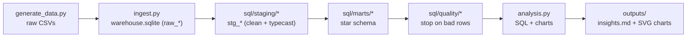
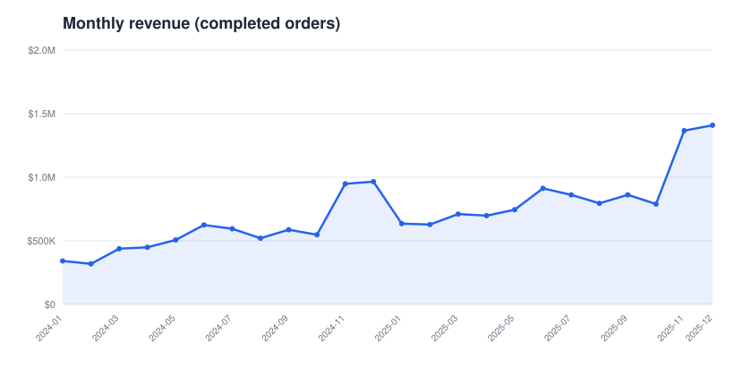
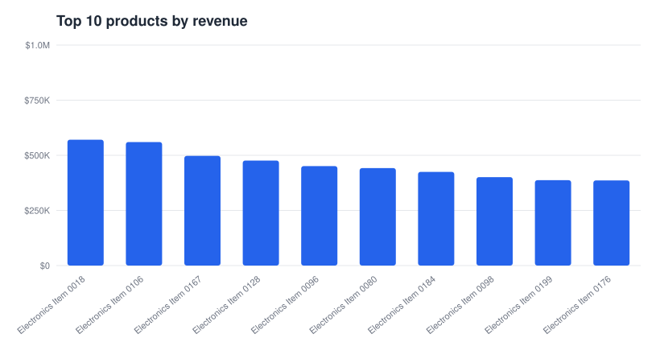
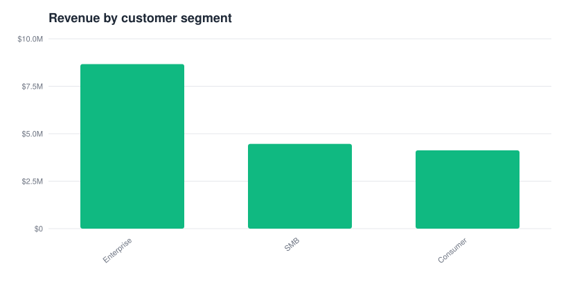
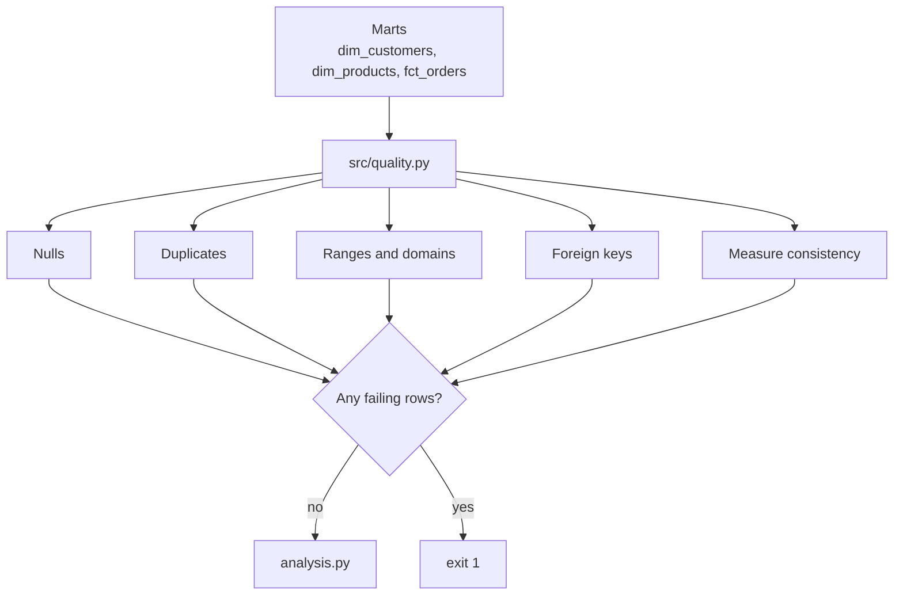

# ecommerce-data-pipeline

I built this to practice the full data flow — not just writing SQL in a notebook, but getting data from raw files into a warehouse, modeling it, and actually answering business questions from it.

It's a fake e-commerce store: Python generates CSVs, loads them into SQLite, SQL builds a star schema (staging → dims + fact), then a few analytics queries write out an insights report and SVG charts. Everything runs on the **Python standard library** — no `pip install` to run the pipeline, no API keys, no cloud account.

The data is **synthetic** (fixed seed in `generate_data.py`), so the numbers aren't real business metrics. But anyone can clone this and reproduce the exact same output with one command, which was kind of the point for a portfolio piece.

---

## Architecture



Classic ELT setup: land raw data untyped, clean it in staging, model into a star schema, check the marts, then query them.

### Star schema (marts)

```
            dim_customers                         dim_products
        (customer_id PK)                        (product_id PK)
        name, country, segment,                 product_name, category,
        signup_date, cohort_month               price, cost, unit_margin
                  \                                   /
                   \                                 /
                    \            fct_orders          /
                     \   grain: one row per order    /
                      ----  line item  --------------
                         order_item_id, order_id,
                         customer_id (FK), product_id (FK),
                         order_date, order_month, status,
                         quantity, unit_price,
                         revenue, cost_amount, gross_profit
```

- **`fct_orders`** — fact table at order-item grain. Measures: `revenue`, `cost_amount`, `gross_profit`. FKs to both dims.
- **`dim_customers`** / **`dim_products`** — conformed dimensions. `cohort_month` on customers is what I used for retention analysis.

---

## What the pipeline found

These come from the last run of `src/analysis.py` — see [`outputs/insights.md`](outputs/insights.md) for the full write-up. Re-running the pipeline reproduces the same numbers.

**Dataset:** 2,000 customers · 200 products · 20,002 orders · 51,892 line items · Jan 2024 → Dec 2025 · **$17.26M** completed revenue.

### Revenue grew +312% over 24 months

Monthly revenue went from **$341,713** (Jan 2024) to **$1,409,233** (Dec 2025). There's a clear Q4 bump in the synthetic data — I baked seasonality into the generator.



### Top products are all Electronics

The top 10 by revenue are Electronics SKUs (high ticket). #1 alone did **$570,884**.



### Enterprise is ~10% of customers but half the revenue

| Segment | Revenue | % of revenue | AOV |
| --- | --- | --- | --- |
| Enterprise | $8.67M | **50.2%** | $2,749 |
| SMB | $4.46M | 25.9% | $752 |
| Consumer | $4.13M | 23.9% | $605 |

Enterprise AOV is about 4.5× Consumer. Small customer count, big spend — the kind of segment you'd want to keep happy.



### Overall AOV is $1,085

15,912 completed orders, average **$1,085**. US is the biggest market at **$6.57M**.

### Cohort retention flattens around ~42%

Signup cohorts: **48.7%** reorder within a month, **45.5%** still active at 3 months, then it levels off near **~42%** by month 6. I used window functions to pool cohorts — details in `src/analysis.py`.

---

## Questions the SQL answers

1. Monthly revenue trend (MoM change with `LAG()`, running total with windowed `SUM()`)
2. Top 10 products by revenue (`RANK()`)
3. Revenue split by segment and country (`SUM() OVER ()` for share-of-total)
4. AOV overall and by segment
5. Signup cohort retention over time

---

## Run it

**Needs:** Python 3.8+. That's it.

```bash
git clone <this-repo>
cd ecommerce-data-pipeline
python3 run_pipeline.py
```

Steps:

```
[1/6] Generate raw data         -> data/raw/*.csv
[2/6] Ingest raw CSVs           -> warehouse.sqlite (raw_* tables)
[3/6] Staging (clean + typecast)-> stg_* views
[4/6] Marts (star schema)       -> dim_customers, dim_products, fct_orders
[5/6] Data quality              -> sql/quality checks (stops here on failure)
[6/6] Analysis (SQL + charts)   -> outputs/insights.md + outputs/charts/*.svg
```

When it finishes, check `outputs/insights.md` and the SVGs in `outputs/charts/`.

---

## Data quality checks

A null key, a duplicated order line, or a price that went negative used to flow straight into the revenue chart. After the marts are built, `src/quality.py` runs the SQL in `sql/quality/` and the pipeline stops if any check returns rows. Analysis only runs when that gate is clean.



Each file under `sql/quality/` is one check. The SELECT lists the bad rows, and an empty result is a pass.

| Category | What it covers |
| --- | --- |
| Nulls | Required columns on both dimensions and `fct_orders`. Blank strings count as missing. |
| Duplicates | `dim_customers.customer_id`, `dim_products.product_id`, and the fact grain `order_item_id`. |
| Ranges | Segment, country, category, and order status; dates outside Jan 2024–Dec 2025 or not a real calendar day; `quantity < 1`; `price <= 0`; `cost < 0`; `cost > price`. |
| Referential | Fact `customer_id` / `product_id` missing from the dimensions, and an order month earlier than the customer's signup month. |
| Consistency | `cohort_month` vs signup date, margins vs price and cost, `revenue` / `cost_amount` / `gross_profit`, `order_month` vs `order_date`. |

SQLite's `date()` rolls impossible days forward (`2024-02-31` becomes `2024-03-02`), so the date checks require the stored value to equal `date(value)`.

On the seeded warehouse this is quiet: 17 checks, 0 violations, then the insights run as usual. The tests also load a small mart with planted problems (null keys, duplicated ids, a negative price, an orphan customer, revenue that doesn't match quantity × price). That fixture fails 16 checks and reports **48 violations** — 24 nulls, 3 duplicate keys, 11 range issues, 7 consistency issues, 3 broken references.

Check a warehouse you already built:

```bash
python3 src/quality.py
```

Run the tests (pytest is only used here; `run_pipeline.py` still has no third-party packages):

```bash
pip install -r requirements-dev.txt
pytest -q
```

GitHub Actions runs that same pytest command on push and on pull requests.

---

## Project layout

```
ecommerce-data-pipeline/
├── run_pipeline.py          # orchestrator
├── requirements.txt         # stdlib only — nothing to install
├── requirements-dev.txt     # pytest, for the quality checks
├── src/
│   ├── generate_data.py     # synthetic CSVs (seed 42)
│   ├── ingest.py            # CSV → warehouse.sqlite
│   ├── quality.py           # run sql/quality checks
│   ├── svg_charts.py        # minimal SVG chart helper
│   └── analysis.py          # business SQL → insights.md + charts
├── sql/
│   ├── staging/             # stg_* views
│   ├── marts/               # dim_* + fct_orders
│   └── quality/             # null / duplicate / range / FK checks
├── tests/                   # pytest for the quality gate
├── .github/workflows/       # CI: pytest on push and pull request
├── data/raw/                # generated CSVs (git-ignored)
└── outputs/
    ├── insights.md
    └── charts/
```

---

## What I was practicing

- **SQL** — joins, aggregations, window functions (`LAG`, `RANK`, `SUM() OVER`)
- **Modeling** — staging → marts, star schema, picking the right grain for the fact table
- **Python (stdlib)** — data generation, ingestion, orchestration without pulling in pandas/etc.
- **Cohort analysis** — retention curve from signup month
- **Charts** — wrote a tiny SVG renderer instead of matplotlib (mostly to keep deps at zero)
- **Data quality** — SQL checks for nulls, duplicate keys, ranges, and foreign keys, with a hard stop before the charts if they fail

---

## About the data

All fake. `src/generate_data.py` uses `random.seed(42)` and tries to mimic realistic patterns — growth over time, Q4 seasonality, segment-based order sizes, occasional discounts. No real customer data anywhere.

If I were taking this further I'd probably swap SQLite for Postgres, add dbt for the SQL layer, and hook up a real BI tool. For now it does what I needed: something I could explain end-to-end in an interview.
