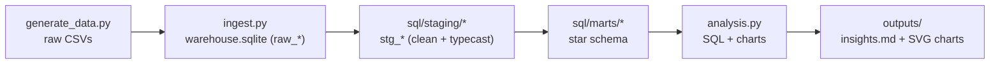

# ecommerce-data-pipeline

An end-to-end, **fully reproducible analytics pipeline** for a synthetic e-commerce business — raw data → warehouse → SQL star-schema modeling → analytics & charts — built with the **Python standard library only** (zero dependencies, runs offline).

It deliberately shows both sides of the data role:

- **Data engineering:** data generation → ingestion into a SQL warehouse → staging + marts modeling (dbt-style layering) → a one-command orchestrator.
- **Data analytics:** business-question SQL (window functions, joins, cohorts), generated insights, and embedded charts.

> The dataset is **synthetic-but-realistic** and generated from a fixed seed, so anyone — including a recruiter — can clone the repo and reproduce every number and chart with a single command. No API keys, no cloud, no `pip install`.

---

## Architecture



The flow is a classic **ELT**: land raw data untyped, clean/typecast it in a staging layer, then model it into a dimensional **star schema** that analytics queries sit on top of.

### Star schema (marts)

```
            dim_customers                         dim_products
        (customer_id PK)                        (product_id PK)
        name, country, segment,                 product_name, category,
        signup_date, cohort_month               price, cost, unit_margin
                  \                                   /
                   \                                 /
                    \            fct_orders          /
                     \   grain: one row per order    /
                      ----  line item  --------------
                         order_item_id, order_id,
                         customer_id (FK), product_id (FK),
                         order_date, order_month, status,
                         quantity, unit_price,
                         revenue, cost_amount, gross_profit
```

- **`fct_orders`** is the fact table at **order-item grain**, with additive measures (`revenue = quantity * unit_price`, `cost_amount`, `gross_profit`) and foreign keys to both dimensions.
- **`dim_customers`** and **`dim_products`** are conformed dimensions. `cohort_month` on the customer dimension powers retention analysis.

---

## Key insights (from the actual run)

These numbers are produced by `src/analysis.py` and written to [`outputs/insights.md`](outputs/insights.md). They are deterministic — re-running the pipeline reproduces them exactly.

**Dataset:** 2,000 customers · 200 products · 20,002 orders · 51,892 order line items · Jan 2024 → Dec 2025 · **$17.26M** total completed revenue.

### 1. Revenue grew +312% over 24 months

Monthly completed revenue climbed from **$341,713** (2024-01) to **$1,409,233** (2025-12), with the expected Q4 seasonal peaks.


### 2. Top products are dominated by Electronics

The top 10 products by revenue are **all Electronics** (high-ticket items), led by one product at **$570,884**.


### 3. Enterprise customers drive half of all revenue

| Segment | Revenue | % of revenue | AOV |
| --- | --- | --- | --- |
| Enterprise | $8.67M | **50.2%** | $2,749 |
| SMB | $4.46M | 25.9% | $752 |
| Consumer | $4.13M | 23.9% | $605 |

Enterprise is ~10% of customers but **50.2%** of revenue, and its **$2,749 AOV** is ~4.5x the Consumer AOV — a classic "whales" pattern worth protecting.


### 4. Overall AOV is $1,085

Across 15,912 completed orders, the average order value is **$1,085**. The US is the largest market at **$6.57M** revenue.

### 5. Cohort retention settles around ~42%

Using a window-function cohort analysis, **48.7%** of a signup cohort reorders within 1 month and **45.5%** are still active at 3 months, leveling off near **~42%** by month 6.

---

## Business questions answered

1. How is monthly revenue trending? (with month-over-month change + running total via `LAG()` and a windowed `SUM()`)
2. What are the top 10 products by revenue? (`RANK()` leaderboard)
3. How does revenue split by customer segment and country? (share-of-total via `SUM() OVER ()`)
4. What is the average order value, overall and per segment?
5. How well do monthly signup cohorts retain over time?

---

## Run it yourself

**Requirements:** Python 3.8+ only. No third-party packages, no internet, no setup.

```bash
git clone <this-repo>
cd ecommerce-data-pipeline
python3 run_pipeline.py
```

The orchestrator runs all five stages and prints clear step logs:

```
[1/5] Generate raw data         -> data/raw/*.csv
[2/5] Ingest raw CSVs           -> warehouse.sqlite (raw_* tables)
[3/5] Staging (clean + typecast)-> stg_* views
[4/5] Marts (star schema)       -> dim_customers, dim_products, fct_orders
[5/5] Analysis (SQL + charts)   -> outputs/insights.md + outputs/charts/*.svg
```

After it finishes, open [`outputs/insights.md`](outputs/insights.md) and the SVG charts in `outputs/charts/`.

---

## Project structure

```
ecommerce-data-pipeline/
├── run_pipeline.py          # one-command orchestrator (generate -> ingest -> SQL -> analyze)
├── requirements.txt         # stdlib only — nothing to install
├── src/
│   ├── generate_data.py     # reproducible synthetic raw CSVs (fixed seed)
│   ├── ingest.py            # load raw CSVs into warehouse.sqlite (raw_* tables)
│   ├── svg_charts.py        # tiny pure-Python SVG bar/line chart helper
│   └── analysis.py          # business-question SQL -> insights.md + charts
├── sql/
│   ├── staging/             # stg_* : clean + typecast (one file per table)
│   │   ├── stg_customers.sql
│   │   ├── stg_products.sql
│   │   ├── stg_orders.sql
│   │   └── stg_order_items.sql
│   └── marts/               # star schema
│       ├── dim_customers.sql
│       ├── dim_products.sql
│       └── fct_orders.sql
├── data/raw/                # generated CSVs (git-ignored)
└── outputs/
    ├── insights.md          # generated narrative + tables
    └── charts/              # generated SVGs (render on GitHub)
```

---

## Skills demonstrated

- **SQL** — JOINs, aggregations, and **window functions** (`LAG`, `RANK`, `SUM() OVER`), plus dimensional modeling.
- **Data modeling** — staging → marts layering and a **star schema** (fact + conformed dimensions) at a well-defined grain.
- **Python** — clean, modular standard-library code (no frameworks) for generation, ingestion, and analysis.
- **ETL / orchestration** — a single reproducible `run_pipeline.py` driving all stages with clear logging.
- **Analytics** — revenue trends, top-N, segmentation, AOV, and **cohort retention**.
- **Data viz** — a from-scratch SVG chart engine; charts render natively in this README.

---

## Note on the data

The dataset is **synthetic but realistic** — generated in `src/generate_data.py` with `random.seed(42)`, modeling growth, Q4 seasonality, segment-driven order sizes, and discounts. Using synthetic data keeps the project **fully reproducible and offline** while still exercising real-world analytics patterns. No real customer data is used.
