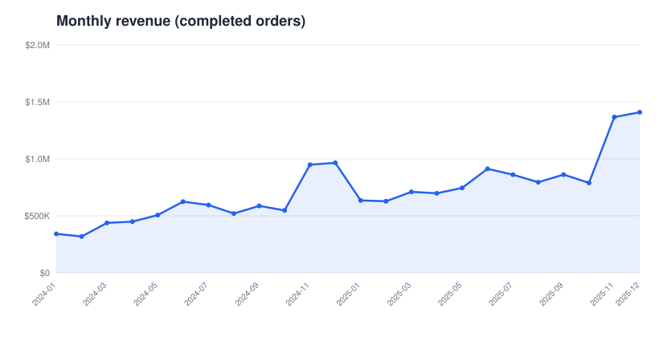
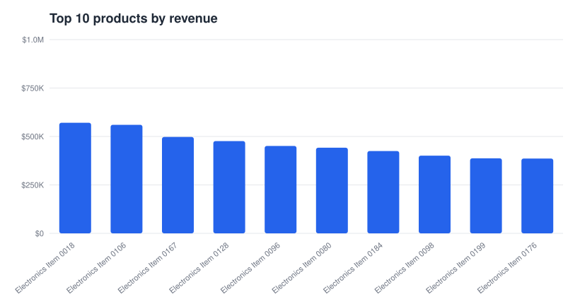
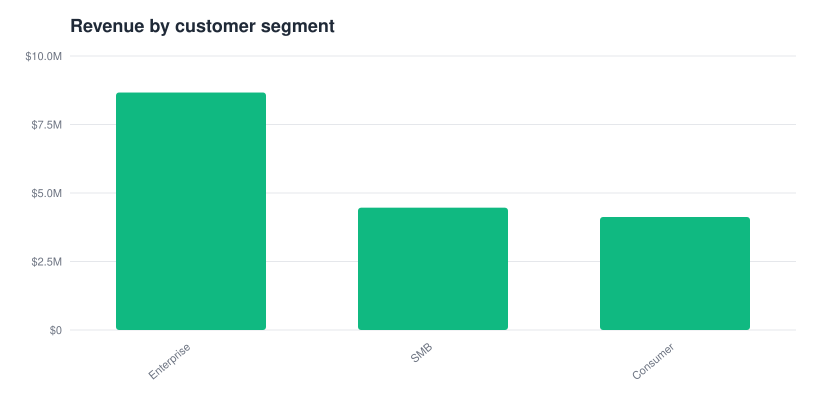

# Key insights

_Written by `src/analysis.py` after a pipeline run on the synthetic dataset (seed 42). Re-run the pipeline and you get the same numbers._

## Dataset

| Metric | Value |
| --- | --- |
| Customers | 2,000 |
| Products | 200 |
| Orders | 20,002 |
| Order line items | 51,892 |
| Date range | 2024-01-01 -> 2025-12-31 |
| Total completed revenue | $17,259,132 |

## 1. Revenue trend

- Revenue went from **$341,713** (2024-01) to **$1,409,233** (2025-12) — about **+312%** growth over the two-year window.
- Peak month: **2025-12** at **$1,409,233**.

## 2. Top products by revenue

| Rank | Product | Category | Revenue | Units |
| --- | --- | --- | --- | --- |
| 1 | Electronics Item 0018 | Electronics | $570,884 | 779 |
| 2 | Electronics Item 0106 | Electronics | $560,130 | 700 |
| 3 | Electronics Item 0167 | Electronics | $497,475 | 723 |
| 4 | Electronics Item 0128 | Electronics | $476,142 | 716 |
| 5 | Electronics Item 0096 | Electronics | $451,253 | 723 |
| 6 | Electronics Item 0080 | Electronics | $441,812 | 739 |
| 7 | Electronics Item 0184 | Electronics | $424,669 | 598 |
| 8 | Electronics Item 0098 | Electronics | $401,202 | 750 |
| 9 | Electronics Item 0199 | Electronics | $387,103 | 729 |
| 10 | Electronics Item 0176 | Electronics | $386,250 | 817 |

## 3. Revenue by customer segment

| Segment | Revenue | Orders | % of revenue |
| --- | --- | --- | --- |
| Enterprise | $8,668,823 | 3,153 | 50.2% |
| SMB | $4,464,598 | 5,936 | 25.9% |
| Consumer | $4,125,710 | 6,823 | 23.9% |

- **Enterprise** alone accounts for **50.2%** of revenue — small segment, big share.

## 4. Revenue by country (top 5)

| Country | Revenue | Orders |
| --- | --- | --- |
| United States | $6,570,460 | 6,082 |
| United Kingdom | $3,093,424 | 2,526 |
| Germany | $2,315,836 | 1,996 |
| Canada | $1,702,087 | 1,452 |
| France | $1,049,314 | 1,156 |

## 5. Average order value (AOV)

- Overall AOV: **$1,085** across **15,912** completed orders.

| Segment | AOV |
| --- | --- |
| Enterprise | $2,749 |
| SMB | $752 |
| Consumer | $605 |

## 6. Signup-cohort retention

Of customers who signed up in a given month, what share placed another completed order N months later (pooled across cohorts with enough history):

| Months since signup | Retention |
| --- | --- |
| 0 | 49.0% |
| 1 | 48.7% |
| 2 | 47.4% |
| 3 | 45.5% |
| 4 | 43.6% |
| 5 | 43.2% |
| 6 | 41.9% |

- **48.7%** reorder within a month of signing up; **45.5%** are still buying at the 3-month mark, then it tapers off.
